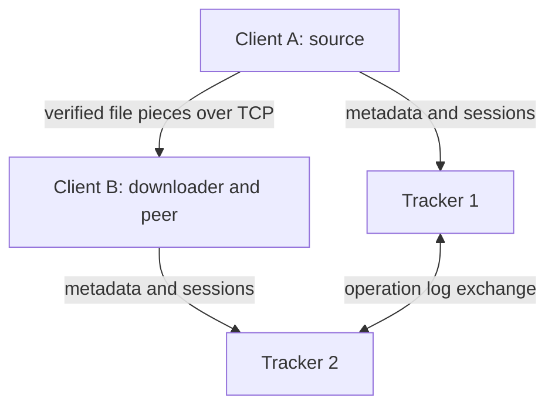

# P2P file sharing

This version extends the supplied user/group and multi-tracker project with peer file serving and downloads.

## 1. Build and run

Requirements: Linux, a C++17 compiler, `make`, and POSIX threads. No OpenSSL, database, torrent library, or `std::filesystem` is used. Python 3 is needed only for the optional black-box tests.

From the project directory:

```sh
make -j2
```

`tracker_info.txt` contains exactly two distinct IPv4 endpoints. Either `IP PORT` or `IP:PORT` is accepted. Blank lines and `#` comments are allowed.

```text
127.0.0.1 9000
127.0.0.1 9001
```

Open separate terminals, with each terminal in the project directory:

```sh
./tracker/tracker tracker_info.txt 1
./tracker/tracker tracker_info.txt 2
./client/client 127.0.0.1:10000 tracker_info.txt
./client/client 127.0.0.1:10001 tracker_info.txt
./client/client 127.0.0.1:10002 tracker_info.txt
```

Run each line in its own terminal. Client addresses must be distinct and reachable by the other clients. For different machines, replace loopback addresses with those machines' reachable IPv4 addresses. Each client binds its advertised address and serves files there. There is no NAT traversal.

The PDF's executable syntax also works from the corresponding directory: `cd tracker`, then `./tracker ../tracker_info.txt 1`; or `cd client`, then `./client IP:PORT ../tracker_info.txt`. Choose a consistent tracker working directory because its logs are relative to that directory.

Enter `quit` to stop either program. Trackers also stop when standard input closes; keep a terminal or an open input pipe attached. `make clean` removes executables, not tracker state.

Optional: set the same `P2P_SYNC_KEY` on both trackers before launching them. The default is `a3-classroom`. This is a classroom trust check, not encrypted or cryptographically authenticated replication.

## 2. Commands

Arguments containing spaces must be quoted. Underscore commands and their two-word forms, such as `create_user` and `create user`, are accepted.

| Command | Action |
|---|---|
| `create_user <uid> <password>` | Create an account; does not log in |
| `login <uid> <password>` | Start a session; replaces that user's previous session |
| `create_group <gid>` | Create a group and become its owner/member |
| `join_group <gid>` | Send a membership request |
| `list_groups` | List groups and owners |
| `list_requests <gid>` | Owner lists pending requests |
| `accept_request <gid> <uid>` | Owner accepts a request |
| `leave_group <gid>` | Leave and remove this user's shares from the group |
| `upload_file <gid> <file_path>` | Hash and advertise a local file; does not send it to the tracker |
| `list_files <gid>` | List files with registered seeders in a group |
| `download_file <gid> <file_name> <destination>` | Start a background download |
| `show_downloads` | Show active, completed and failed jobs |
| `stop_share <gid> <file_name>` | Stop serving the named file |
| `logout` | Cancel downloads and stop all local sharing; revoke the tracker session |
| `help` / `quit` | Show usage / exit gracefully |

IDs are 1–64 ASCII letters, digits, `_` or `-`. Passwords are 1–256 characters. File names may contain spaces, but not `/`, bytes below ASCII 32, `.` or `..`. A source must be a regular file of at most **1 GiB (1,073,741,824 bytes)**. FIFOs and directories are rejected.

The upload argument order is **group first, path second**. A destination may be an existing directory or a new filename whose parent already exists. Existing destination files, including symlinks, are never replaced. Upload uses the resolved source basename. For example, uploading a symlink advertises the target's basename.

Completed output follows the assignment format:

```text
[C] [lab] image.bin
```

An active job displays `[D] [lab] image.bin - 7 pieces verified`. A failure displays `[F]` and a reason. `show_downloads` refreshes the view; downloading continues while the command prompt is available. At most three downloads are active per client, with four chunk workers per download.

`stop_share` does not cancel an in-progress download. It disables its partial sharing and keeps it disabled after completion. `logout`, `leave_group`, and `quit` cancel the relevant unfinished downloads. Local completed files are not deleted. An already-authorized response in flight may finish after a revocation; subsequent requests are rejected.

If a tracker cannot be contacted during logout, local downloads/sharing are still stopped, but the local session token is retained so logout can be retried. A subsequent successful login replaces any previous session and removes its stale shares. Abruptly killed clients can leave stale tracker advertisements; downloaders skip unreachable peers.

## 3. Short demonstration

Client A:

```text
create_user alice pass
login alice pass
create_group lab
upload_file lab "/absolute/path/sample.bin"
```

Client B:

```text
create_user bob pass
login bob pass
join_group lab
```

Client A:

```text
list_requests lab
accept_request lab bob
```

Client B:

```text
list_files lab
download_file lab sample.bin /absolute/path/download-directory
show_downloads
```

Wait for `[C]`. Stop sharing from A, then use a third accepted group member to download from B. To demonstrate tracker failover, stop one tracker and issue commands using the surviving tracker; restart the stopped tracker in its original working directory.

## 4. Architecture and files

Trackers store metadata. File bytes travel directly between clients. Each client is both a command-line requester and a peer server.



| File pair (`include/*.h`, `src/*.cpp`) | Responsibility |
|---|---|
| `common/net` | IPv4 sockets, framed messages, timeouts, config and tracker-log file I/O |
| `common/hash` | Incremental SHA1 implementation |
| `common/fileInfo` | File metadata, chunk sizes, streaming hashing, positional file I/O and descriptor ownership |
| `tracker/state` | Users, sessions, groups, file metadata and command authorization |
| `tracker/sync` | Ordered operation log, persistence, deduplication and replication |
| `tracker/tracker` | Tracker listener, bounded worker queue, request dispatch and console |
| `client/client` | User command parsing and orchestration |
| `client/link` | Thread-safe tracker requests and failover |
| `client/files` | Local shared files and verified-piece bitmaps |
| `client/peer` | Peer listener, bounded serving pool and per-request access checks |
| `client/download` | Background jobs, parallel chunk workers, retries, verification and progress |
| `client/src/main.cpp`, `tracker/src/main.cpp` | Small executable entry points |

`main` is necessarily a free function in C++; application behavior lives in classes. Composition separates network I/O, state, serving and downloading without an unnecessary inheritance hierarchy. `Fd` closes a descriptor when its owning object is destroyed. `shared_ptr<LocalFile>` keeps a source descriptor alive until in-flight users release it.

Key data structures:

- `map<uid, User>` stores password digests, session tokens and peer addresses.
- `map<gid, Group>` contains owner, member/pending sets and file records.
- A file record contains size, whole SHA1, a vector of piece SHA1s, and `uid -> session token` seeders.
- An ordered map keyed by `(logical clock, tracker number)` provides deterministic replay.
- Local files are keyed by `(group, filename)` and have a string bitmap, one character per piece.
- Mutexes protect shared maps, queues and status. Atomics handle cancellation, counters and task assignment.

## 5. File transfer algorithm

1. **Upload:** resolve/open a regular file, hash it in 512 KiB reads, detect changes during hashing, retain the same descriptor, and send metadata to the tracker. Same-name/same-content peers are allowed; different metadata under the same group/name is rejected.
2. **Discover:** an authenticated group member asks a tracker for metadata and peer endpoints. The downloader excludes its own endpoint.
3. **Prepare:** create a unique `destination.part.<random>` file with `O_EXCL`, size it using `ftruncate`, then register a local partial share. Initially every bitmap bit is `0`.
4. **Select:** four workers take distinct indexes using an atomic counter. Piece `i` first tries peer `i % peerCount`; other peers are tried in rotation. Ask a peer for its current bitmap before requesting a piece.
5. **Verify/write:** check the received length and piece SHA1. Only then use `pwrite` at `index * 512 KiB`, mark its bitmap bit, and increment progress. A verified piece can immediately be served to another peer.
6. **Retry:** try alternate peers on corrupt, missing or interrupted responses. Refresh tracker discovery between up to four rounds. Cancellation stops new work; ongoing network calls have bounded waits.
7. **Finish:** `fsync`, stream through the completed file for whole-file SHA1 and piece checks, then publish with `link(temp, destination)` and remove the temporary name. `link` refuses to overwrite a destination created concurrently.
8. **Fail:** remove the local partial share, attempt tracker deregistration, unlink the owned temporary path and report `[F]`. If deregistration cannot reach a tracker, the remaining advertisement is stale but cannot serve data.

The empty file has no pieces and uses SHA1 of the empty byte string. The last nonempty piece may be shorter than 512 KiB. At 1 GiB, a file has 2,048 pieces. File size does not determine the buffer allocation size: hashing and transfer are incremental.

## 6. TCP protocol

Each TCP connection carries one request and one response. TCP supplies a byte stream, so application framing is mandatory.

| Frame component | Size / encoding |
|---|---|
| Magic | 4 bytes: `P2P2` |
| Body length | 4-byte unsigned integer in network byte order |
| Body SHA1 | 40 lowercase ASCII hexadecimal bytes |
| Body | Count and length-prefixed byte strings |

Body: a 4-byte field count followed by repeated `4-byte length + field bytes`. Fields may contain NUL bytes, making file transfer binary-safe. The body is capped at 8 MiB and 100,000 fields. Nested vectors use the same body encoding.

| Message | Fields |
|---|---|
| Client to tracker | `CMD`, request ID, packed command arguments |
| Tracker replication | `SYNC`, shared key, packed operation entries |
| Peer bitmap query | `BITMAP`, requester token, gid, filename, whole SHA1 |
| Peer piece query | `PIECE`, requester token, gid, filename, whole SHA1, decimal piece index |
| Peer success | `OK`, bitmap or binary piece |
| Tracker success/error | `OK`, optional data / `ERR`, code, message |
| Peer error | `ERR`, message |

Internal tracker commands are `peers`, `start_share`, and `authorize`. `upload_file` internally carries token, group and encoded metadata rather than a local path. `authorize` checks both the requesting member and the serving session against current tracker state. A peer never receives a remote filesystem path.

Send/receive loops handle partial transfers, interrupted calls and disconnects. A complete send frame or receive frame has a 10-second monotonic deadline, including header and body, so a peer cannot keep a worker indefinitely by trickling bytes. Connect waits up to one second. `MSG_NOSIGNAL` prevents a closed connection from killing the process. These are per-operation limits, not an overall end-to-end download deadline.

## 7. Tracker synchronization and persistence

Both trackers can accept commands. A successful write gets an entry `(clock, trackerNo, requestId, arguments)`. Before acknowledging it, the tracker saves its operation log. It exchanges the full log with its peer periodically (approximately every second), before commands, and after successful writes. A concurrent outgoing sync may cause an immediate sync attempt to be skipped; the periodic exchange remains active.

Both trackers union entries and replay them in `(clock, trackerNo)` order. Repeated request IDs are applied once. The client reuses an ID while failing over within the same request. Manually retyping a command creates a new request ID.

Logs are `groupsTracker1.log` / `groupsTracker2.log` in each tracker's working directory. The old names are retained for compatibility, but now contain file operations too. The file contains a SHA1 checksum plus encoded entries. Writes use a temporary file, `fsync`, and `rename`; a lock file prevents two processes from owning the same tracker log. A corrupt log causes startup failure instead of silent data loss. Existing user/group-stage logs remain readable. Do not run old and new tracker binaries together after adding file operations.

**Consistency limit:** this is eventual consistency, not consensus. If disconnected trackers accept conflicting operations, both may initially report success. On reconciliation, deterministic replay can reject one operation or invalidate later operations that depended on it. Reads and revocations may be stale during a partition. This preserves availability with either tracker down, but cannot promise globally current information during arbitrary partitions. The assignment's strict freshness wording is therefore not fully guaranteed in that scenario. See the technical report for an example and the trade-off.

Never delete just one live tracker's log to reset the system. It can reuse logical-clock identities that conflict with the surviving history. Preserve logs across restarts. For a fresh demo, stop both trackers and all clients, back up the logs, then start both trackers in a new empty working directory with the same config.

## 8. Tests

From the project directory:

```sh
make test
make test-large
```

`make test` builds/runs C++ unit tests and Python black-box tests. `make test-large` repeats integration with an exact 1 GiB file; allow at least about 2.2 GiB free temporary disk space. Tests choose local ports, create temporary working directories, launch compiled executables, and clean up their own processes/data. They do not use your existing tracker logs. Loopback socket access is required. The fault suite uses simulated peers to inject corruption and disconnects.

See `TEST_RESULTS.md` for the checks actually executed. Manual follow-ups: run on separate Linux machines; test slow links, full disks, and firewall-induced partitions in your own environment. No claim is made that every possible interleaving or operating-system failure has been tested.

## 9. Limits and assumptions

- Exactly two IPv4 trackers; small assignment-scale workloads. Fixed pools: four tracker workers, eight peer workers, and queues of 32 pending connections.
- Full-log replication/replay is easy to follow but inefficient as history grows. The approximately 8 MiB log limit rejects further writes; there is no compaction. Do not erase a single log as a workaround.
- A file's group/name metadata remains reserved even when all seeders stop. It can be re-shared with identical metadata; changing content requires a new filename or group.
- No restart-resume for partial downloads. Graceful failure removes temporary files; a killed process can leave uniquely named `.part.*` files for manual cleanup. Restarted clients must log in and upload existing files again to advertise them.
- No heartbeat leases: `list_files` lists registered seeders, not proof that their processes are alive. Actual connections/bitmaps determine usable pieces.
- SHA1 checks catch ordinary corruption; they are not a secure MAC. Password digests, bearer sessions and sync keys are sent over unencrypted TCP. This is a trusted-LAN teaching project, not an Internet-facing service.
- Persistence flushes file contents but not parent directories. This covers tested process restarts; full power-loss durability of directory entries is not guaranteed.
- No guarantee of finishing if all seeders disappear. Bounded retries report a failure instead of waiting forever.
- No rarest-first scheduling or cross-restart piece cache. Round-robin starting peers and unique chunk assignment are the chosen simple strategy.

Start reading `client.cpp`, then `fileInfo.cpp`, `download.cpp`, `peer.cpp`, `net.cpp`, `state.cpp`, and finally `sync.cpp`. `TECHNICAL_REPORT.md` explains the choices and includes viva questions.
