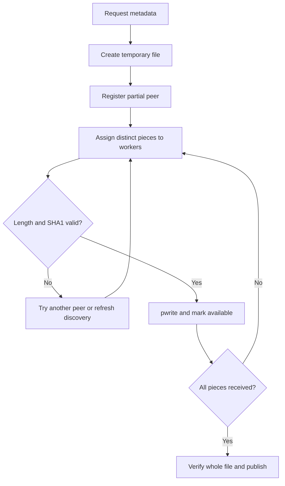

# Technical report — AOS Assignment 3

**Roll number:** 2026201045  
**Implementation:** C++17, Linux POSIX sockets and file calls  
**Scope:** Completed file-sharing extension to the supplied user/group and replicated-tracker project

## 1. Problem and approach

A single file server becomes a bottleneck when everyone downloads from it. Here, clients keep the actual files and serve pieces directly to one another. A tracker supplies the information needed to find those clients: user sessions, group membership, file identities and peer addresses. A second tracker provides an alternative when one tracker is unavailable.

The important distinction is metadata versus data. `upload_file` registers a name, length and hashes; it does not copy the file to the tracker. `download_file` first discovers peers through a tracker, then fetches file bytes from those peers. A downloader becomes a useful source as soon as it has verified a piece.

The existing account/group implementation was retained. New classes handle local file ownership, peer requests and downloading. This avoids turning `Client::runCmd` into one large networking/file-processing function.

## 2. Class design

| Class | Owns or controls | Why separate it? |
|---|---|---|
| `Client` | Prompt, current session, command dispatch | User interaction changes independently of transfer logic |
| `Link` | Tracker endpoints and preferred endpoint index | Every worker can use the same failover behavior |
| `Files` | Map of shared local files | One synchronized lookup path for uploads, downloads and peers |
| `LocalFile` | Descriptor, immutable metadata, availability bitmap | Keeps piece availability associated with the exact open file |
| `Peer` | Listener, connection queue and serving workers | Incoming requests continue while the prompt waits for input |
| `Downloads` | Collection of background jobs | Enforces the limit on simultaneous files |
| `Download` | One file's workers, progress, cancellation and temporary output | One failed file need not stop unrelated jobs |
| `FileInfo` | File metadata and positional I/O helpers | Tracker and client validate the same metadata format |
| `Net` | Framing and socket/file utility methods | Both executable types share one wire format |
| `State` | User/group/file rules | State transitions can be replayed without networking |
| `Sync` | Durable ordered history and state reconstruction | Replication is separate from command permissions |
| `Tracker` | Accept loop, request workers and console | Network concurrency is separate from state rules |

Encapsulation is used to protect invariants: a caller cannot directly change `LocalFile`'s bitmap or `Sync`'s log. Composition is sufficient; artificial base classes would add complexity without useful polymorphism. A few small stateless utility classes have static methods. This remains class-based while keeping the code understandable for a student.

`Fd` demonstrates resource ownership: its destructor closes the descriptor, and copying is disabled to prevent double closes. Shared ownership of `LocalFile` is justified because the local-file map and in-flight peer requests may use it at the same time. Download job history releases its file reference after finishing, so a stopped share does not keep its descriptor open solely for progress display.

## 3. End-to-end download flow

For a file size `S` and piece size `B = 524288`, the number of pieces is `(S + B - 1) / B`. Piece `i` begins at byte `i * B` and has length `min(B, S - i * B)`. For example, 1,048,583 bytes produce three pieces of 524,288, 524,288 and 7 bytes.

The file is represented by an ordered vector of piece hashes plus one whole-file hash. Piece order matters: receiving correct bytes for the wrong position is not sufficient. `pwrite` writes at the calculated offset without changing a shared file-position cursor, so four workers can write different ranges concurrently.

A worker sets the availability bit only after the complete verified piece has been written. The mutex used by `mark` and peer-side bitmap/piece reads provides the necessary synchronization. A peer sees either an unavailable piece or an already-written piece. Reading arbitrary unverified ranges is not supported.

## 4. Piece selection and retry strategy

An atomic counter assigns each piece index once. This avoids duplicate successful downloads and avoids a central locked work queue for such a small workload. Workers operate concurrently, not as four sequential calls.

The initial peer rotates with the piece index. With peers A and B, piece 0 first tries A, piece 1 first tries B, piece 2 first tries A, and so on. This uses multiple peers even if the first peer could serve the whole file. Availability is checked with a bitmap; a partial peer need not possess every piece.

If a peer disconnects, sends malformed framing, returns an unavailable piece, or sends bytes with the wrong length/hash, the worker tries the next peer. It refreshes discovery between rounds, with a short pause, up to four rounds. Repeated attempts are intentional on failure; unique assignment avoids duplicate normal work inside the same download.

This is simpler than rarest-first selection. It is appropriate for the assignment's small number of clients, but can be less efficient in a large swarm with uneven piece availability. A possible extension is to collect all bitmaps and schedule the piece present at the fewest peers. That extension is not implemented.

## 5. Socket concepts used in the implementation

A TCP socket is an operating-system endpoint identified in the process by an integer descriptor. A listener and each accepted connection are different descriptors. Closing one client connection does not close the listener.

The server sequence is `socket -> setsockopt -> bind -> listen -> accept`. The client sequence is `socket -> connect`. Both sides then exchange framed bytes with `send`/`recv`, and close their connection descriptors. The operating system handles TCP ordering and retransmission; the application still has to reconstruct messages from a stream.

| Call / typical syntax | Return and purpose in this project |
|---|---|
| `socket(AF_INET, SOCK_STREAM, 0)` | New descriptor, or `-1`; creates an IPv4 TCP endpoint |
| `setsockopt(fd, SOL_SOCKET, SO_REUSEADDR, &value, sizeof(value))` | `0` or `-1`; listener address reuse, not permission to run duplicate listeners |
| `bind(fd, (sockaddr*)&addr, sizeof(addr))` | `0` or `-1`; associates a listener with a local address/port |
| `listen(fd, 32)` | `0` or `-1`; enables accepting incoming TCP connections |
| `accept(fd, nullptr, nullptr)` | New connection descriptor, or `-1`; used after listener readability |
| `connect(fd, (sockaddr*)&addr, sizeof(addr))` | `0` on immediate success; nonblocking `EINPROGRESS` is checked using `poll` and `SO_ERROR` |
| `poll(&item, 1, timeoutMs)` | Positive ready count, `0` timeout, or `-1`; bounds waiting without busy loops |
| `send(fd, data, len, flags)` | Number of bytes accepted locally, or `-1`; may send fewer than requested |
| `recv(fd, data, len, flags)` | Positive bytes, `0` orderly end-of-stream, or `-1`; may return a partial message |
| `close(fd)` | `0` or `-1`; releases descriptor ownership |

Failures use `errno`; retrying after `EINTR` is different from retrying a broken connection. `sendAll` and `recvAll` advance by the number of bytes actually transferred, not by the requested length. A successful `send` does not prove that the remote application has processed the command, which is why request IDs are necessary for write retries.

`htons`/`htonl` convert integer fields to network byte order. `inet_pton` parses IPv4 text. File paths are never encoded in peer requests: the server chooses from its registered local files by group/name/hash.

### Why not newline-delimited file messages?

Binary files may contain newline and NUL bytes. A length-prefixed format carries them unchanged. The fixed 48-byte header tells the receiver how many body bytes to read, and the body contains individually length-prefixed fields. Bounds are checked before allocating the body. A frame checksum verifies the body before unpacking; piece and whole-file hashes provide independent content checks.

`recvMsg` uses one deadline for the whole frame. Resetting a timeout after each successful byte would allow an extremely slow sender to retain a worker indefinitely. The absolute monotonic deadline avoids that. There are still normal resource limits: enough simultaneous slow connections can fill the bounded pool until their deadlines expire.

## 6. File system calls and integrity

| Call | Use |
|---|---|
| `open(path, flags, mode)` | Open sources and create exclusive temporary output files; returns descriptor or `-1` |
| `fstat(fd, &stats)` | Confirm a regular file and determine length/timestamps; returns `0` or `-1` |
| `pread(fd, buf, n, offset)` | Read a source chunk without changing a shared cursor; bytes/EOF/`-1` |
| `pwrite(fd, buf, n, offset)` | Write a verified chunk at its final offset; bytes or `-1` |
| `ftruncate(fd, size)` | Set the temporary file's length; returns `0` or `-1`; does not guarantee disk capacity is reserved |
| `fsync(fd)` | Flush file data before publication/log acknowledgment; returns `0` or `-1` |
| `link(temp, final)` | Publish a verified download without replacing an existing name; returns `0` or `-1` |
| `unlink(temp)` | Remove a temporary name; does not invalidate an already-open descriptor |
| `rename(temp, log)` | Atomically replace a tracker's saved log name |
| `flock(fd, LOCK_EX \| LOCK_NB)` | Prevent a second process from using the same tracker log |

For example, chunk 3 is written using `pwrite(fd, data, dataLength, 3 * 524288)`. If only part is written, `FileInfo::writeAt` advances both the buffer pointer and file offset and retries the remaining bytes. Disk-full errors become a failed download rather than a completed file with missing data.

A source is hashed through the same descriptor later used for seeding. Size and modification/change timestamps are compared around initial hashing. Each served piece is hashed again, so modifying an uploaded source does not silently distribute bytes inconsistent with its advertisement. This is corruption detection, not a cryptographic defense against an attacker who controls hashes and content.

The downloader keeps incomplete data under a temporary name. After verifying all pieces and the whole file, it creates the final directory entry using `link`. Using an unconditional `rename` here would allow replacement of a destination another process created during the download. The temporary file is in the same parent directory, avoiding a cross-filesystem hard-link operation.

Parent directories are not fsynced. Consequently the implementation does not claim complete power-loss durability of names, even though process restart persistence is tested. Abrupt termination can leave a `.part.*` name; automatic recovery of it is outside the implementation.

## 7. Tracker synchronization in detail

### Entry creation

A write command is checked on a copy of `State`. If it is valid, the tracker increments its logical clock and appends an entry containing the clock, its tracker number, a random request ID, and the original command arguments. It reconstructs state and persists the new log. A failed save removes the added entry and rebuilds the preceding state.

Successful command arguments contain deterministic values. Login tokens are generated by the client and stored in the operation, rather than randomly generated during replay. Group ownership after an owner leaves is the lexicographically first remaining member, because ordered sets produce the same choice on both trackers.

### Exchange and replay

Each side sends a full snapshot of its known entries. The receiver adds entries it lacks, rejects conflicting bytes with the same `(clock, trackerNo)` identity, sorts by that identity, and replays the combined history. The response carries its log back so the initiating side can also learn missing entries.

Networking does not hold the state mutex. A separate outgoing-sync lock prevents concurrent full-log exchanges by the same tracker. A failed connection leaves the local tracker usable. Restarting with the existing log restores users, sessions, groups and file advertisements; periodic exchange adds operations missed while it was offline.

The same client request can reach both trackers if the first committed it but its reply was lost. Request-ID deduplication ensures one state effect after reconciliation. Retrying after a network error does not guarantee the original command failed; the CLI explicitly mentions that uncertainty.

### Conflict example and limitation

Suppose both trackers know clock 10. During a partition, tracker 1 accepts `create_group lab` for Alice and tracker 2 accepts it for Bob. Both append clock 11 and can initially acknowledge success. After reconnecting, `(11,1)` sorts before `(11,2)`. Alice's group is created first; Bob's replayed creation gets `EXISTS`. Both final states converge, but Bob's earlier success cannot be treated as a permanently committed consensus decision.

The same issue can affect sessions, membership and authorization. Therefore this algorithm does **not** fully meet a literal requirement for globally current reads during partitions. Two isolated writable replicas cannot both provide that guarantee while remaining available. A stricter design must sacrifice some partition availability, for example by restricting writes to a single authoritative leader with a safe fencing/quorum mechanism. This project preserves the supplied availability-oriented design and makes the limitation explicit.

Full-history replication is convenient for explanation and debugging, but total work grows with history. Each write replays history and rewrites the log; synchronization transfers the whole history. The implementation caps the log rather than silently discarding old entries. Snapshotting, compaction, deltas and a production consensus protocol are future work, not hidden features.

## 8. Concurrency and shutdown

The tracker has four worker threads and the peer server has eight. Both use a bounded queue; excess accepted sockets are closed. This avoids unbounded thread creation. A client can have three active file jobs, each with four workers.

`LocalFile`'s mutex protects bitmap/enabled state. `Files` protects map membership. The download's sharing lock serializes initial partial registration with `stop_share`, preventing completion from unexpectedly enabling a share that the user stopped. Workers use an atomic next index, verified-piece counter and cancellation flag.

On logout/quit, background jobs are cancelled and joined, local shares are disabled, the session is revoked when a tracker can be reached, and the peer server is stopped. Joining matters: destroying `Files` while a peer worker still refers to it would be unsafe. Stopping sharing removes map visibility but shared ownership keeps descriptors valid for operations already using the file object.

Cancellation is cooperative. It does not forcibly interrupt every syscall; existing bounded network operations finish or time out. An already-authorized response in flight cannot be retroactively recalled.

## 9. Challenges and solutions

| Challenge | Chosen solution |
|---|---|
| TCP splits and combines messages | Fixed header plus length-prefixed body, exact-read/write loops |
| Incorrect bytes with otherwise valid framing | Expected length and piece SHA1, alternate-peer retries |
| Peer vanishes after advertising | Connection deadline, bitmap queries, alternate peers and refreshed discovery |
| Different workers overwrite shared file position | `pread`/`pwrite` with explicit offsets |
| Source changes after upload | Retained descriptor and per-served-piece hashing |
| Stop-share races with registration | A per-download sharing lock and disabled local file state |
| Existing destination appears during download | Atomic no-overwrite hard-link publication |
| Same endpoint spelled with a padded port | Normalize the numeric config port before duplicate comparison |
| Repeated write after a lost reply | Stable request ID across tracker failover and replay deduplication |
| Tracker log is corrupt or already in use | Checksum validation and an exclusive process lock |

## 10. Validation and remaining work

`TEST_RESULTS.md` records the executed checks. The most important outcomes are exact byte integrity through 1 GiB, contribution by multiple peers, continued downloading when a peer disappears, rejection of corrupted chunks, verified partial seeding, and tracker convergence after reconnection.

The next useful work would be multi-machine testing under controlled packet loss/latency, directory fsync for power-loss durability, session leases, log compaction, and a deliberately redesigned consistency policy. These require additional implementation and validation; they are not claimed as complete.

## 11. Viva study prompts

1. Why can one `recv` return only half a header? Follow `Net::recvAll`.
2. Why does `accept` return a new descriptor? Find where listeners and connections are closed.
3. What would go wrong if four workers used `lseek` followed by `write` on the same descriptor?
4. At what exact line does a partial chunk become available to another peer?
5. Why retain both piece hashes and a whole-file hash?
6. Trace a corrupted response through `Download::fetch` to the alternate peer.
7. Why is a successful `send` insufficient evidence that a tracker command failed or succeeded?
8. What happens if the group owner leaves? Why must the choice be deterministic?
9. Explain the partition conflict above without claiming that convergence means strong consistency.
10. Why is SHA1 not a substitute for TLS or message authentication?
11. Why is `ftruncate` not proof that enough disk space exists?
12. What would you change to resume downloads after a process restart?

For hands-on learning, first change the number of download workers to two and compare behavior. Then instrument which peer supplies each piece. Finally add a new read-only group command to `State`, the client dispatcher and the tests. Keep each experiment separate from the tested submission copy.

## 12. References and attribution

- Supplied `AOS_Assignment_3.pdf`, IIIT Hyderabad, Monsoon 2026: requirements, commands, transfer sizes and submission format.
- Supplied `2026201045_Assignment3.zip`: original class-based user/group, framing, SHA1 and tracker-log implementation retained and extended.
- Linux manual pages for local study: `man 2 socket`, `man 2 bind`, `man 2 listen`, `man 2 accept`, `man 2 connect`, `man 2 poll`, `man 2 send`, `man 2 recv`, `man 2 pread`, `man 2 pwrite`, `man 2 fsync`, `man 2 link`, `man 2 rename`, and `man 2 flock`.
- SHA1 specification for further reading: RFC 3174. No third-party hashing or torrent implementation is linked into this project.

The extension was developed with AI assistance. This report describes the delivered implementation and its limits; it does not substitute for understanding the source during evaluation.
